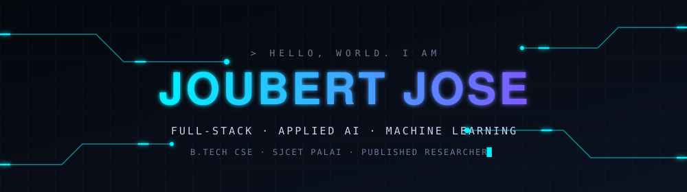

<!-- PROFILE README: save this repo as  joubertjose/joubertjose  (repo name == your username) -->

<div align="center">



<br/>

<a href="https://github.com/joubertjose">
  
</a>

<br/><br/>

<a href="mailto:joubertjose200614@gmail.com"></a>
<a href="https://github.com/joubertjose"></a>


<br/>


</div>


## `01` &nbsp;/&nbsp; whoami

```console
joubert@sjcet:~$ whoami
joubert jose — computer science student at St. Joseph's College of Engineering
and Technology, Palai (B.Tech CSE, 2024–2028, currently 4th semester).

joubert@sjcet:~$ cat mission.txt
building intelligent software systems through full-stack engineering,
applied AI, and machine learning.

joubert@sjcet:~$ cat now.txt
→ sharpening DSA fundamentals in Python
→ exploring LLMs, RAG, and autonomous agents
→ shipping ML + IoT systems that touch the real world

joubert@sjcet:~$ _
```


## `02` &nbsp;/&nbsp; current operations

<table>
  <tr>
    <td width="33%" valign="top">
      <h3>📚 Learning</h3>
      <ul>
        <li>Data Structures &amp; Algorithms <sub>(Python)</sub></li>
        <li>Operating Systems</li>
        <li>Computer Organization &amp; Architecture</li>
      </ul>
    </td>
    <td width="33%" valign="top">
      <h3>🛠️ Building</h3>
      <ul>
        <li>Full-stack applications</li>
        <li>ML / IoT systems</li>
        <li>Backend projects</li>
      </ul>
    </td>
    <td width="33%" valign="top">
      <h3>🔬 Researching</h3>
      <ul>
        <li>LLMs &amp; RAG</li>
        <li>Multimodal AI</li>
        <li>Autonomous agents</li>
      </ul>
    </td>
  </tr>
</table>


## `03` &nbsp;/&nbsp; selected work

<table>
  <tr>
    <td width="50%" valign="top">
      <a href="https://github.com/joubertjose/joubert-ai-tutor">
        
      </a>
      <br/>
      <sub>🧠 <b>Agentic RAG tutoring system</b> — context-aware learning with document intelligence and streaming responses.</sub><br/>
      
      
      
      
      
    </td>
    <td width="50%" valign="top">
      <a href="https://github.com/joubertjose/joubert-tasknebula">
        
      </a>
      <br/>
      <sub>🌌 <b>Project management platform with AI copilot</b> — task orchestration, analytics, PostgreSQL backend.</sub><br/>
      
      
      
      
    </td>
  </tr>
  <tr>
    <td width="50%" valign="top">
      <a href="https://github.com/joubertjose/joubert-rag">
        
      </a>
      <br/>
      <sub>📄 <b>Hybrid RAG document intelligence</b> — structure-aware parsing, reciprocal rank fusion, neural reranking, BYOK Gemini execution.</sub><br/>
      
      
      
      
      
    </td>
    <td width="50%" valign="top">
      <a href="https://github.com/joubertjose/joubert-automl-studio">
        
      </a>
      <br/>
      <sub>⚙️ <b>No-code ML platform</b> — preprocessing, model training, evaluation, and deployment pipeline.</sub><br/>
      
      
      
      
    </td>
  </tr>
  <tr>
    <td width="50%" valign="top">
      <a href="https://github.com/joubertjose/joubert-predictive-maintenance">
        
      </a>
      <br/>
      <sub>🏭 <b>Industrial failure prediction</b> — XGBoost-based analytics for equipment maintenance scheduling.</sub><br/>
      
      
      
    </td>
    <td width="50%" valign="top">
      <a href="https://github.com/joubertjose/JoubertMart">
        
      </a>
      <br/>
      <sub>🛒 <b>Responsive e-commerce front-end</b> — product catalog, cart, checkout, registration.</sub><br/>
      
      
      
      
    </td>
  </tr>
</table>


## `04` &nbsp;/&nbsp; tech arsenal

<div align="center">

**Languages**

 <sub>+ Tcl</sub>

**Web**


**AI / ML & Backend**

<br/>


**Systems & Tools**

 <sub>+ IoT · Operating Systems</sub>

</div>


## `05` &nbsp;/&nbsp; research

> ### 🌱 Solar-Powered IoT & ML-Based Smart Irrigation System
> **Peer-reviewed · IJRPR · April 2025**
>
> Combines IoT sensor data with a machine learning model to optimize irrigation decisions, powered by a solar supply chain — sustainable agriculture meets applied ML.

<div align="center">

<!-- 👉 Replace the two "#" links below once you have the real URLs -->
<a href="#"></a>
<a href="#"></a>

</div>


## `06` &nbsp;/&nbsp; github telemetry

<div align="center">


</div>

<sub>📡 All stats are live — pulled straight from GitHub, no placeholders.</sub>


## `07` &nbsp;/&nbsp; roadmap

- [x] Ship an agentic RAG tutor with streaming responses
- [x] Publish peer-reviewed IoT + ML research (IJRPR, April 2025)
- [x] Build a hybrid RAG pipeline with reranking
- [ ] Master DSA fundamentals in Python
- [ ] Go deep on Operating Systems & Computer Architecture
- [ ] Build and deploy a multi-agent autonomous system
- [ ] Win a hackathon 🏆


## `08` &nbsp;/&nbsp; contact

<div align="center">

**Happy to talk IoT / ML systems, hackathons, or systems programming.**

<a href="mailto:joubertjose200614@gmail.com"></a>
<a href="https://github.com/joubertjose"></a>

<br/>


</div>
